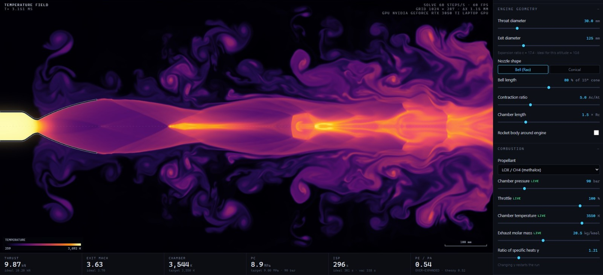
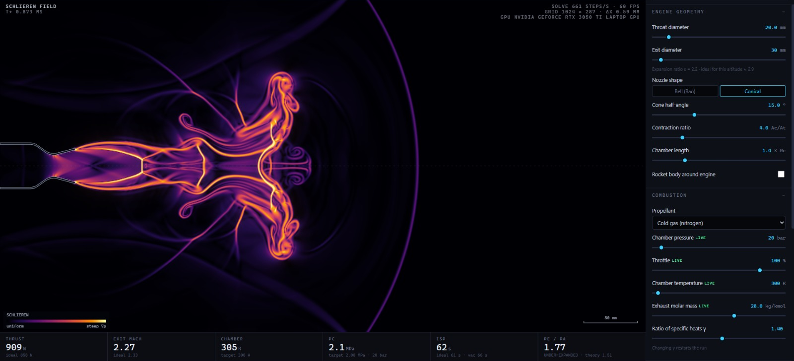
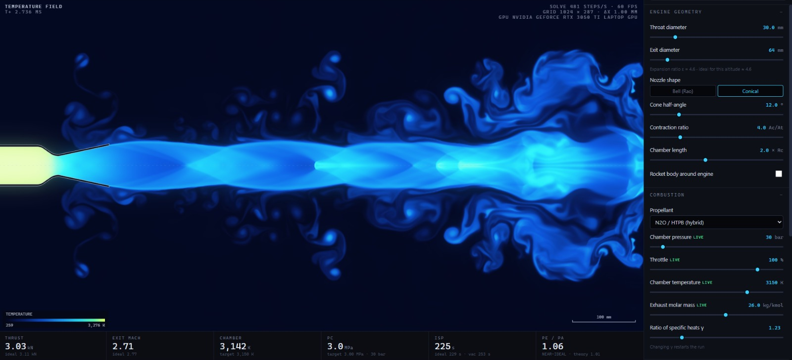

# Rocket Nozzle CFD Solver

A real-time, GPU-accelerated compressible-flow solver for rocket engines and their exhaust plumes. It runs in Chrome or Edge, with nothing to install.

**To run it:** download `Rocket Nozzle CFD Solver.html` and double-click it. If it opens in a different browser, right-click → *Open with* → Chrome or Edge.

| | |
|---|---|
|  |  |
| **Schlieren.** A cold-gas thruster starting up, with the start-up shock and vortex ring. | **Hybrid motor.** N2O/HTPB with a conical nozzle, close to ideal expansion. |

*These screenshots were taken before viscosity, turbulence and afterburning were added, so the current version's plumes and readouts will differ.*

---

## What it solves

It solves the **compressible Navier-Stokes equations** on a 2-D axisymmetric grid. The grid covers the combustion chamber, the converging–diverging nozzle and the air around the engine. Shock diamonds, Mach disks, expansion fans, boundary layers, separation, afterburning and the plume changing with altitude all come out of the solution.

| | |
|---|---|
| Equations | 2-D axisymmetric Navier-Stokes, plus transport of exhaust fraction and unburnt fuel |
| Method | Finite volume, MUSCL (van Leer) reconstruction, HLLC Riemann solver (switches to HLL at strong shocks to stop the "carbuncle" glitch), SSP-RK2 time stepping, CFL time step computed on the GPU |
| Viscosity | Sutherland's law, plus an eddy viscosity: Smagorinsky in open flow and a mixing length inside the engine, with a Ducros sensor so shocks aren't treated as turbulence |
| Walls | **Cut-cell** (embedded boundary): cells that straddle the nozzle wall use their true fluid volume and face openings, and slivers are merged into a neighbour for stability. A simpler stepped-wall mode is available for comparison. |
| Boundary layer | Wall model: Werner-Wengle shear at reference-temperature properties, and Reynolds-analogy heat transfer to a wall at the temperature you set |
| Separation | The shock's upstream influence through the thin subsonic layer is modelled with Zukoski's plateau pressure rise (p₂/p₁ = 1 + M/2). The reversed flow and the separated region are then computed. |
| Gas model | Two calorically perfect gases, exhaust and air, each with its own γ and molar mass. γ in mixed cells follows the mixture and is advected in the form that keeps pressure uniform across material interfaces (Abgrall 1996; Johnsen & Colonius 2006). |
| Afterburning | One global reaction between fuel-rich exhaust and air, limited by the slower of turbulent mixing and a finite-rate ignition limit, so it fades with altitude. The heat release and air demand for each propellant are estimates from chemical equilibrium at a typical fuel-rich mixture ratio (solid motor and hydrazine worked out by hand). |
| Boundaries | Stagnation inlet at the injector face (your Pc and Tc) that absorbs chamber acoustics, far-field pressure, supersonic/subsonic outflow |
| Ambient | US Standard Atmosphere 1976, 0–45 km; optional flight Mach (free-stream) |

### Limits
- **Turbulence is modelled, not fully resolved.** Real turbulence is 3-D. In this 2-D axisymmetric grid the large eddies are ring-shaped, and the model stands in for everything smaller.
- **The boundary layer is only a few cells thick.** The wall model and the separation closure supply what the grid can't resolve, so the separation point depends on the closure and is an estimate.
- **Afterburning is one global reaction.** There's no detailed chemistry, soot or radiation. The exhaust's molar mass and γ don't change as it burns.
- **γ depends on the mixture, not on temperature,** and the chamber is a uniform hot-gas source rather than a simulated flame.
- **Grid resolution.** The solver keeps at least 8 cells across the throat radius by default, shortening the domain if it has to. Raise the grid to see more plume. The cell size is snapped so the throat area, and so the mass flow, is exact.

### How close is it to theory?
Medium grid (1024 × 287), measured at the exit plane after the start-up transient:

| Preset | | Chamber pressure | Mass flow | Thrust | Isp |
|---|---|---|---|---|---|
| Kerolox demo, 196 bar, sea level | 1-D ideal | 196 bar | 4.51 kg/s | 13.78 kN | 312 s |
| | Simulated | 195.1 bar | 4.46 kg/s | 13.22 kN | 301 s |
| Methalox shock diamonds, 90 bar | 1-D ideal | 90 bar | 3.45 kg/s | 10.20 kN | 301 s |
| | Simulated | 90.2 bar | 3.44 kg/s | 9.83 kN | 289 s |
| N2O/HTPB hybrid, 30 bar | 1-D ideal | 30 bar | 1.38 kg/s | 3.11 kN | 229 s |
| | Simulated | 30.6 bar | 1.42 kg/s | 3.10 kN | 220 s |

The 3–4 % Isp shortfall is what you'd expect from divergence, wall friction and heat loss. With viscosity switched off, the kerolox demo gives 307–308 s on the same grid, so friction and heat transfer account for about 2 % of it.

**Flow separation.** Hydrolox vacuum bell at 120 bar, ε = 64, at sea level:

| | Summerfield criterion | Simulated |
|---|---|---|
| Wall pressure / ambient at separation | 0.40 | 0.49 |
| Separation point, as a share of bell length | 42 % (using 1-D pressure) | 58 % |

The two positions differ partly because 1-D theory underestimates the wall pressure in a bell. On the simulated wall, the pressure falls to 0.40 × ambient at about 63 % of the bell length.

Downstream of that point, the near-wall flow runs back up the bell at around 20–40 m/s, at close to ambient pressure.

**Chamber ringing.** After a hard start on the kerolox demo, the raw chamber pressure varied by ±2.1 bar without acoustic damping and ±0.6 bar with it. On the normal ignition ramp it varies by ±0.3 bar. The injector face absorbs the sound, and its slow-moving inflow speed then brings the chamber to its target. Cold gas takes longest, because its speed of sound is lowest: the cold-gas preset was still 6 % high at 0.8 ms.

---

## Controls

**Top tabs:** temperature · Mach · Schlieren · pressure · density · velocity · vorticity · exhaust fraction · flame (a "what it might look like" render) · eddy viscosity · afterburn.

**Right panel**
- **Presets** (top dropdown): over-expanded vacuum bell at sea level, shock diamonds, ideal expansion, high-altitude under-expanded (big Mach disk), upper stage at 30 km, cold-gas thruster, hybrid motor, supersonic flight with a rocket base.
- **Engine geometry:** throat and exit diameter, bell (Rao) or cone, bell length or cone angle, contraction ratio, chamber length, optional rocket body. These are *live*: drag them while it runs and the walls re-mesh in place.
- **Combustion:** propellant presets set Tc, γ and molar mass. Chamber pressure, throttle, Tc, molar mass and afterburn energy are live. Changing γ restarts the run.
- **Viscous & reacting flow:** switch viscosity and turbulence on or off, set the nozzle wall temperature, and switch afterburning on or off. All three apply live, so you can compare a run with the inviscid case.
- **Flight & environment:** altitude and flight Mach (live). **Ascent mode** sweeps altitude (and speed) over a set real-time duration. **Throttle sweep** cycles 40–100 %.
- **View:** colour map, mirror (full plume), **split view** (a different field below the axis, e.g. temperature on top and Schlieren underneath), sonic line / Mach contours, tracer particles, glow (bloom), Schlieren sensitivity, flame brightness.
- **Simulation:** grid resolution, minimum cells across the throat radius, domain length (plus "Fit domain to engine"), wall model (cut-cell or stepped), start-up mode (ignition ramp or diaphragm burst), chamber acoustic damping, CFL, 1st/2nd order, and reset-to-defaults.
- **Theory vs simulation:** 1-D ideal nozzle numbers (Cf, c*, Isp, optimum ε, Pe/Pa, …) next to what the solver measures at the exit plane.

**Mouse:** hover for local T, p, Mach, velocity, density · scroll to zoom · drag to pan · double-click to reset the view.

**Keys:** `Space` play/pause · `R` restart · `N` single step · `1–9` fields · `C` sonic line / Mach contours · `P` particles · `M` mirror · `F` fit view · `V` record · `S` screenshot · `H` hide panel · `Shift+T` self-test.

**Recording:** `● Record` captures the view with the readouts burned in (MP4 in current Chrome/Edge, otherwise WebM). Pick the frame under *Recording*: window, 1080p, 4K, **portrait 1080×1920** or square. Tip: turn the speed slider down for slow-motion start-ups.

Your settings are remembered between sessions in this browser. "Reset all settings to defaults" (Simulation section) clears them.

---

## Speed tips
Measured on a laptop with an RTX 3050 Ti in Chrome, raw solver speed:

| Grid | Steps per second |
|---|---|
| Draft 384 × 108 | ≈ 1,470 |
| Low 640 × 179 | ≈ 1,140 |
| Medium 1024 × 287 (default) | ≈ 590 |
| High 1536 × 430 | ≈ 285 |
| Ultra 2048 × 573 | ≈ 160 |

Switching viscosity and afterburning off raises Medium to about 750 steps per second. A full start-up and settled plume (about 1 ms of simulated time) takes roughly 15–25 s on Medium. Separation in the over-expanded preset takes about 3 ms to settle, or about a minute.

- **Make sure the browser uses the NVIDIA GPU:** Windows Settings → System → Display → Graphics → *Add desktop app* → the browser's `.exe` → Options → *High performance*. The top-right readout shows which GPU is in use, in amber if it's integrated graphics.
- The app chooses how many steps to run per frame automatically. It adds steps while the GPU keeps up and backs off when work piles up. The **Speed** slider sets the maximum; the label shows e.g. `12/20 st/fr` when it's holding back.
- Chrome's **Energy saver** (Settings → Performance) caps pages at 30 fps on battery. It still works, just more slowly.
- If the graphics driver ever resets, the app recovers by itself, steps the grid down one level and carries on.
- **Self-test:** Help → *Run self-test*, or press `Shift + T`. It checks every preset, view and feature on your GPU, measures speed at each grid size, and reports pass/fail. Your settings are restored afterwards.
- **Brave works too.** Set it to High performance in the same Windows Graphics page. If the readouts jitter, turn Shields off for this page; its fingerprinting protection adds noise to GPU readbacks.

## Files
- `Rocket Nozzle CFD Solver.html`: the whole app, a single self-contained file that works offline.
- `README.md`: this file.
- `images/`: the screenshots above.
- `source/`: the same code split into modules (physics, solver, renderer, UI) if you want to read or modify it. Run `python build.py` in that folder to rebuild the single HTML file.
